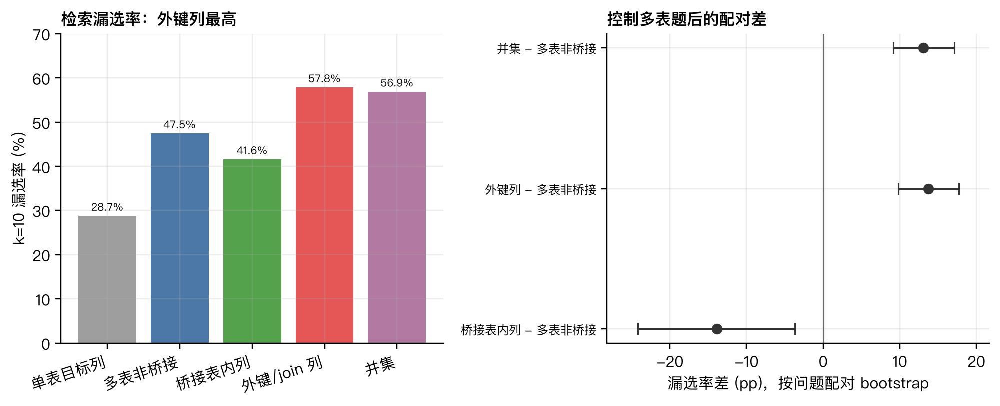
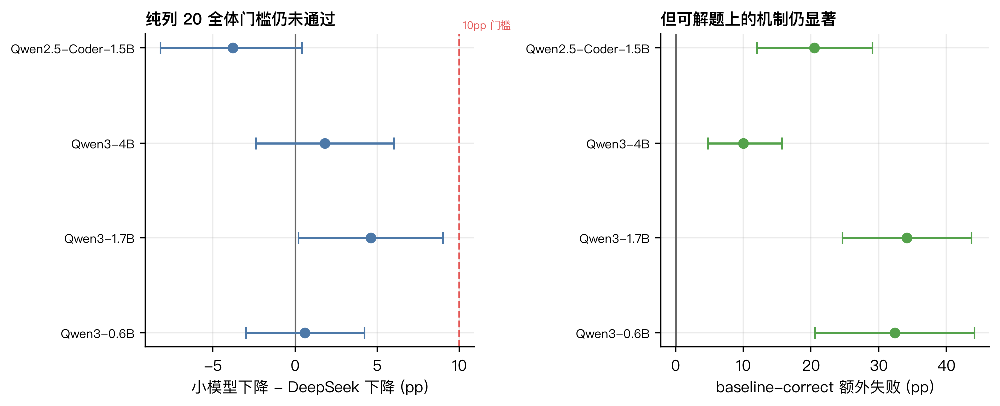

# 小模型 Schema 鲁棒性与向量检索外键偏差（两页版）

*BIRD Mini-Dev SQLite，500 题，11 库；Qwen3-0.6B/1.7B/4B、Qwen2.5-Coder-1.5B、DeepSeek*

## 结论先行

- **检索偏差是外键/连接列，不是桥接表**：控制多表题后，外键/连接列比普通目标列
  更难召回 +13.75pp（95% CI [+9.79, +17.73]），桥接表内列反而不更难（−13.91pp）。
- **加入 20 个真实无关列的主门槛不通过**：四个小模型相对 DeepSeek 的额外下降为
  0.00 到 +5.10pp，均低于预注册的 10pp。
- **条件效应存在**：在双方基线都可解的题上，小模型保持率显著更低
  （+16.5 到 +51.9pp）。

## 实验设计

| 条件 | 说明 | 题数 |
| --- | --- | ---: |
| base | 仅 gold 表与列 | 500 |
| 多给 20 列·任意表 | 20 个全库真实无关列 | 431 |
| 多给 20 列·仅 gold 表 | 20 个 gold 表内真实无关列 | 224 |
| 漏给 | 移除桥接表 / 外键列 | 103 / 494 |

评分用 BIRD 官方集合语义 + 30 秒超时；检索用 MiniLM 向量化，k=10，问题级配对 bootstrap。

## 检索结果

| 类别 | 漏选率 |
| --- | ---: |
| 单表目标列 | 28.71% |
| 多表非桥接目标列 | 47.45% |
| 桥接表内列 | 41.60% |
| 外键/连接列 | 57.85% |

外键/连接列显著更难召回（+13.75pp），桥接表本身不构成额外偏差。

## 执行结果

| 模型 | base | 任意表 | 仅gold表 |
| --- | ---: | ---: | ---: |
| DeepSeek | 68.6% | 67.1% | 56.7% |
| Qwen3-0.6B | 14.8% | 12.1% | 7.6% |
| Qwen3-1.7B | 27.6% | 23.7% | 15.6% |
| Qwen3-4B | 50.4% | 42.5% | 37.1% |
| Qwen2.5-Coder-1.5B | 26.4% | 20.9% | 18.3% |

相对 DeepSeek 的额外下降：任意表 +0.46/+2.09/+5.10/+3.25pp；仅 gold 表
0.00/+1.34/+0.89/−1.79pp。四模型均未达到 +10pp。

| 模型 | 基线可解子集·额外失败 | 95% CI |
| --- | ---: | --- |
| Qwen3-0.6B | +28.33pp | [+16.67, +41.67] |
| Qwen3-1.7B | +29.82pp | [+21.05, +38.60] |
| Qwen3-4B | +16.50pp | [+11.00, +22.50] |
| Qwen2.5-Coder-1.5B | +37.50pp | [+26.92, +48.08] |

## 漏给结果

移除桥接表或外键列后，严格合规准确率都很低（1.26%–11.11%）；DeepSeek 的普通执行优势
主要来自读取或猜中被隐藏的连接列。

## 一句话

原「小模型总体比大模型多下降 10pp」的假设未获支持；但检索外键偏差与「基线可解子集上的
条件效应」都稳定存在，说明研究重心应转向外键检索与条件鲁棒性，而不是无关列数量本身。

## 下一步

Spider 2.0-Lite SQLite 复验，主指标改为「基线可解子集上的保持率差」，先做功效分析；
Qwen3-0.6B 是否进入确认性门槛作为独立决策。
