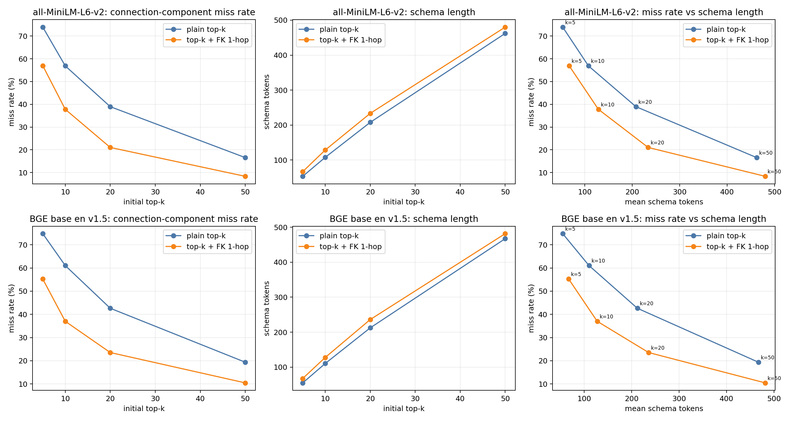

# BIRD Mini-Dev：Schema 扰动、外键检索与老师反馈整合报告

更新：2026-10-26。本报告属于 `BIRD_MINIDEV_VALIDATION_20261025_server/teacher_feedback_20261026/`，在服务器主版本上补充今天完成的反馈核查、BGE 对照和外键一跳实验。主实验的变体、预测、既有评分和原门槛以父目录服务器批次为准。旧补实验仍在兄弟目录 [BIRD_MINIDEV_VALIDATION_20261013_server_old](../../../BIRD_MINIDEV_VALIDATION_20261013_server_old/)，本文仅在解释参照群体时引用其历史结果。

## 1. 核心结论

外键/关键连接列更容易被向量检索漏选。top-10 下，MiniLM 的外键列漏选率为 57.85%，单表目标列为 28.71%，相差 +29.14 pp；BGE 对应 61.54% 与 31.10%，相差 +30.44 pp，95% CI [+23.15,+37.68] pp。换用 BGE 后现象仍存在。

最小外键一跳扩展改善召回：top-10 桥接成分并集漏选率由 MiniLM 的 56.88% 降至 37.79%，BGE 由 61.05% 降至 37.02%；平均 schema token 数分别增加约 21 和 17。尚未证明 SQL 下游准确率或严格相同 token 预算下的优势。

random20 下 API 相对下降 9.33%，Qwen3-0.6B 下降 31.51%，差 +22.18 pp，95% CI [+6.49,+36.27] pp；其他三种小模型的差值区间均跨 0。原绝对下降门槛作为历史检验保留，不能据此直接写“小模型不存在脆弱性”，也不能笼统声称所有小模型都显著更脆弱。

synonym20 的高下降受到提示 schema 与物理库不一致影响。30 条有效失败中，26 条引用物理库不存在的生成列，3 条投影不匹配，1 条 SQL 不完整。隐藏桥接表的 18 个执行成功中，11 个读取隐藏表，4 个使用其他未提供 schema，仅 3 个遵守可见 schema，其中一条又是错误连接导致的结果集合误匹配。

## 2. 数据、批次与评分

- BIRD Mini-Dev 500 题、11 库：86 单表、414 多表。检索任务信息仅来自 question；BGE 使用推荐的固定检索查询指令，不加入 evidence。
- 主实验：base 500；random 与 synonym 的 5/10/20/50 列扰动共 4,000；隐藏桥接表 103、隐藏外键列 494；合计 5,097 变体。原始变体位于服务器主目录的 [perturbations/output/](../../perturbations/output/)，原始预测与评分位于 [model_eval/](../../model_eval/)。
- 旧版本 [output/scores/](../../../BIRD_MINIDEV_VALIDATION_20261013_server_old/output/scores/) 中每模型 1,000 条主要属于 base + pure-column 补实验，仍在旧目录，不与主实验覆盖混算。本次新增产出均在本增量包的 `output/` 内。
- 相对下降主分析使用五个模型共同可评分的 494 题，排除 gold 超时题 116、129、145、159、518、701；另保留 historical paired-500 视图。相对比例不受这 6 条全条件不可评分题影响。
- 桥接表条件有 99 个可评分变体；只在提示词隐藏表，数据库始终保留原表。
- 主版本服务器 scorer 对浮点数保留 8 位再做集合匹配，本次桥接审计复现相同口径。另保留可选官方 scorer 复核入口，使用精确元组集合比较，增加评分版本、不可评分 gold 单列和续跑输入校验；它不替代服务器主版本评分。各批次原评分不变。

## 3. MiniLM / BGE 原假设对照

top-10，按题聚类 bootstrap 10,000 次，补充统计 seed=20261026。历史 seed 的旧区间也保留，因此端点有小幅抽样差异。

| 检索器 | 单表列漏选率 | 外键/连接列漏选率 | 差值 | 95% CI |
| --- | ---: | ---: | ---: | --- |
| MiniLM | 28.71% | 57.85% | +29.14 pp | [+21.42,+36.70] pp |
| BGE base en v1.5 | 31.10% | 61.54% | +30.44 pp | [+23.15,+37.68] pp |

BGE 在这组任务中普通列检索没有优于 MiniLM，结果如实保留。两者使用相同列文档、候选集合和标签；全部 500 题的 top-50 排名均已保存并复核原评估器分母。

[旧版本的 matched-baseline 分析](../../../BIRD_MINIDEV_VALIDATION_20261013_server_old/结论.md)控制了多表题难度，外键差值约 +13.75 pp（95% CI [+9.79,+17.73]）。它与单表对照使用不同参照群体，不能互相替换。匹配对照下桥接表列未显示额外劣势，也不能把外键偏差扩大为所有桥接成分的共同偏差。

## 4. 最小外键扩展与 token 代价

先取 top-k 列，只从这个原始集合沿声明外键加入对端列，去重后结束；新增列不继续展开，未使用 gold 选择扩展边。

指标为 391 个具有桥接成分标签的问题上 1,032 个列标签并集的漏选率，与上节单独外键列指标不同。token 数使用同一个 Qwen3-0.6B tokenizer 对所选列的 schema 文本计数，不含完整提示、问题、evidence、生成 SQL 或额外外键说明文本。

| 检索器 | k | 原漏选率 | 扩展后漏选率 | 原 token | 扩展后 token |
| --- | ---: | ---: | ---: | ---: | ---: |
| MiniLM | 5 | 73.93% | 56.98% | 53.3 | 66.8 |
| MiniLM | 10 | 56.88% | 37.79% | 107.6 | 128.5 |
| MiniLM | 20 | 38.95% | 21.03% | 207.7 | 233.4 |
| MiniLM | 50 | 16.57% | 8.33% | 462.1 | 480.2 |
| BGE | 5 | 74.81% | 55.23% | 55.0 | 67.6 |
| BGE | 10 | 61.05% | 37.02% | 110.4 | 127.6 |
| BGE | 20 | 42.64% | 23.55% | 212.2 | 235.9 |
| BGE | 50 | 19.38% | 10.47% | 467.1 | 481.5 |

top-10 漏选率下降为 MiniLM 19.09 pp（95% CI [16.89,21.28]）、BGE 24.03 pp（95% CI [21.78,26.26]）。

## 5. 执行准确率相对下降

定义：`(base accuracy − perturbed accuracy) / base accuracy`。配对 bootstrap 同时重采样同题所有模型的 base/扰动结果，每次重算各模型的基线分母。低基线比例更不稳定，故同时保留准确率、绝对差与区间。

| 模型 | base（494题） | random20 | random 相对下降 | 比 API 多下降 | 差值 95% CI | synonym 相对下降 |
| --- | ---: | ---: | ---: | ---: | --- | ---: |
| API | 69.43% | 62.96% | 9.33% | — | — | 60.06% |
| Qwen3 0.6B | 14.78% | 10.12% | 31.51% | +22.18 pp | [+6.49,+36.27] | 63.01% |
| Qwen3 1.7B | 27.33% | 22.06% | 19.26% | +9.93 pp | [−2.55,+21.52] | 58.52% |
| Qwen3 4B | 51.21% | 44.13% | 13.83% | +4.50 pp | [−3.06,+11.77] | 63.64% |
| Qwen2.5-Coder 1.5B | 27.13% | 24.49% | 9.70% | +0.37 pp | [−13.60,+12.45] | 48.51% |

历史 500 题表中 API base=68.6%、0.6B base=14.6%，相对下降仍为 9.33% 和 31.51%。两种分母及全部区间见 [相对下降报告](../output/teacher_feedback/relative_execution/report.md)。

历史“多掉至少 10 个绝对百分点”门槛未通过。相对下降为事后补充分析，不包装成新的预注册通过判据。旧真实列补实验、条件保持率数据仍在 [旧版本目录](../../../BIRD_MINIDEV_VALIDATION_20261013_server_old/)，不与本轮合成列干扰混算。

## 6. synonym20 构造与 30 条失败

生成器只向提示 schema 添加元数据，未 ALTER SQLite 或填值。10,000 个添加条目中，2,168 个同名、7,832 个词典近义；9,859 个条目名物理不存在，141 个碰巧与真实列同名。`generated=True` 是来源标记，不保证物理不存在。

旧随机样本混入 gold 超时 q116、q145，本轮保留排除说明，用相同种子从旧样本外的可评分失败补入 q1457、q1105。最终 30 条 gold 全部成功执行。

| 主分类 | 数量 |
| --- | ---: |
| 引用不存在的生成列 | 26 |
| 投影不匹配（q1145、340、341） | 3 |
| SQL 不完整（q944） | 1 |

这 30 条中未发现一个可执行、仅因等价近义列命名不同而被 gold 判错的答案。发现 10 条 gold/evidence/题意疑点，与主分类可重叠；优先确认 q1275 的编码、q1322 的分组与总数、q219 的条件方向、q341 的重复 OR、q989 的姓名输出缺失。保留原 gold 和评分，不据此重标全部题目。

这是模型辅助 SQL 审阅，CSV 保留 `human_verdict`、`human_notes`，未获得独立人工签字。26/30 只描述固定错误样本，不可外推全部 500 题或其他模型的占比。

## 7. 隐藏桥接表的 18 个成功

103 个隐藏表均仍在 SQLite。18 个成功的预测/gold 全部只读复现，SQLite authorizer EXPLAIN 记录实际表列，并验证禁读规则会拒绝相应访问。

| 来源 | 数量 |
| --- | ---: |
| 读取隐藏桥接表 | 11 |
| 使用其他未提供表或列 | 4 |
| 仅用可见 schema | 3 |

仅允许访问提示 schema 时，集合匹配成功为 3/99=3.03%，仍不等于语义正确率。q260、q263 通过共享 molecule_id 绕过 molecule；q149 错令 account_id=district_id，但 gold 461 行与预测 DISTINCT 1 行都只有 DISPONENT，集合评分判对。q637 也有预测 2 行、gold 5 行而去重后相同的现象。

evidence 未以隐藏表限定名直接给出这些表，但保留了多处隐藏列名。访问日志证明使用了未提供 schema，无法确定表名来自猜测、推断还是已有知识。本次核查不需要物理删除源表。

## 8. 反馈产出及边界

| 要求 | 结果目录 |
| --- | --- |
| 相对下降与配对区间 | `output/teacher_feedback/relative_execution/` |
| 近义列构造/物理存在性 | `output/teacher_feedback/construction/` |
| 30 条有效错误审阅 | `output/teacher_feedback/synonym20/` |
| 18 条桥接表成功来源 | `output/teacher_feedback/bridge_api_successes/` |
| 外键一跳、漏选率/token 曲线 | `output/retrieval_fk/` |
| BGE 原假设对照区间 | `output/retrieval_fk/original_hypothesis_report.md` |

代码与命令见本增量包的 [README](../README.md)。新增验证覆盖一跳边界、原单表分母、无效 gold 排除、抽样身份、SQLite 访问限制、配对区间和评分续跑；来源评分及变体的 SHA-256 记录在相应核查 JSON 中。

真实有效近义列/值控制、同 token 预算比较、下游 SQL 执行与跨数据集验证属于后续研究。本次交付包括截图要求的分析、最小实现和服务器主版本的增量报告；歧义案例的人工确认栏仍需研究者填写。
