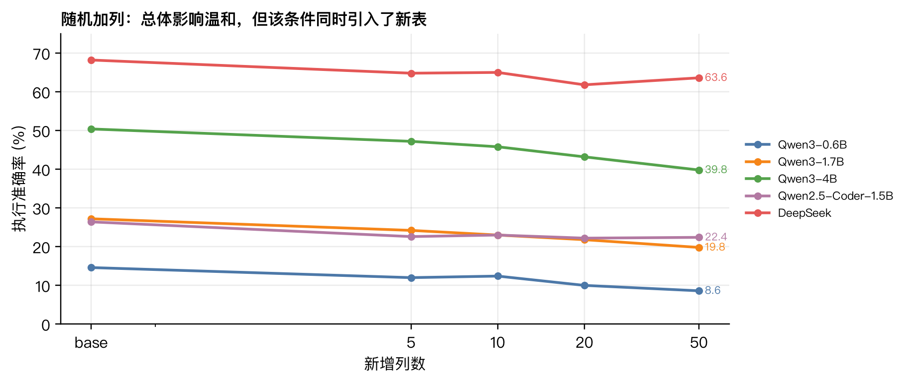
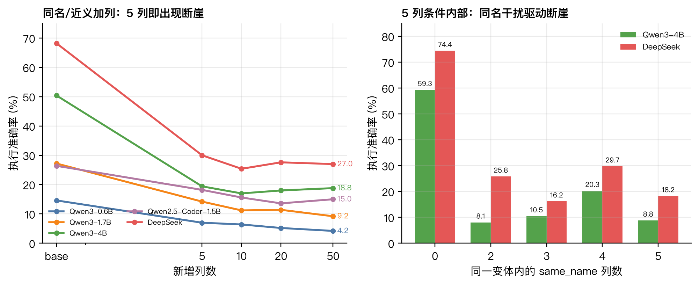

# BIRD Mini-Dev 7–8 周验证性实验（两页版 v2）

*小模型 Schema 鲁棒性与外键检索偏差*

数据：BIRD Mini-Dev SQLite，500 题，11 库；模型：Qwen3-0.6B/1.7B/4B、
Qwen2.5-Coder-1.5B、DeepSeek deepseek-chat。

## 结论先行

- **原预注册 10pp 全体门槛不通过**：随机 20 列的下降差为 -2.20 到 +0.80pp，
  95% CI 上界最高 +5.2pp；数据可排除“小模型多下降 10pp”。
- **纯列 20 补实验仍不通过全体门槛**：下降差 +0.60/+4.60/+1.80/-3.80pp，
  CI 上界均 <10pp；但 baseline-correct 额外失败仍为 +10.00 到 +34.13pp。
- **检索偏差是外键/join 列，不是桥接表**：控制多表题后，桥接表内列
  -13.91pp，外键/join 列 +13.75pp。

## 需要修正的三点

1. 原 `add_random_*` 同时引入新表：20 列时 494/500 个变体至少新增一张表，
   58.9% 的新增列来自新表。它不能回答“只加无关列”的问题。
2. 原 `add_synonym_5` 中 63.5% 是 `same_name`；5 列断崖主要来自同名干扰，
   不是纯词法近义。
3. 真实近义列 423/427 题也引入新表，只有 4 题是 gold-only；不能把
   41.22pp→6.32pp 全归因于“真实 vs 合成”。

## 请导师决定

| 方案 | 做法 | 评价 |
| --- | --- | --- |
| A 50 题 pilot | 官方可见的 50 题，base + 20 列 | 可立即做，但功效不足：0.6B 共同正确约 5 题 |
| B 补 85 条 gold SQL | 到 135 题，重跑确认性实验 | 最接近原计划；0.6B 仍可能不足 30 题 |
| C 表级 135 题 | 用 gold tables 全部列当 baseline | 不需要缺失 SQL，但研究变量变成表级 |
| D 收缩 RQ1 | 以 BIRD + 可用 Spider 结果做系统实证 | 风险最低，符合任务书兜底 |

建议：**A 先做 pilot + 向作者申请剩余 gold SQL；确认性主指标改为
baseline-correct，并把 0.6B 是否退出 gate 作为独立决策。** 若 RQ3 要立住，
需再补 retrieved-schema 执行条件（约 2,500 条预测）。

## 一句话

原假设没有被确认，但失败原因已经定位：不是“无关列数量”，而是
**外键检索、同名干扰和 baseline 条件效应**。下一步应换主指标、补样本量，
而不是继续在原 10pp 门槛上加解释。
